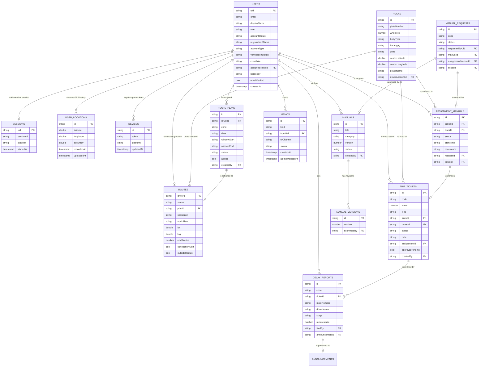

# EcoConnect — Entity Relationship Diagram

Data model derived from the models in `lib/features/**/models`, the document paths in
`firestore.rules`, and the write paths in the services.

## How to read this

EcoConnect keeps everything in **Cloud Firestore**, a document database, so an ERD
here means something slightly different from an SQL one:

- **No foreign keys.** A field like `driverId` is just a string that holds another
  document's id. The services and `firestore.rules` keep it consistent; the storage
  layer does not enforce it.
- **No joins.** Screens read a denormalised copy stored on the record
  (`requesterName`, `driverName`, `plateNumber`, `authorName`) instead of looking up
  the `users` document.
- **Arrays are not tables.** `history`, `responses`, `comments`, `signatures`,
  `routePoints`, `stops` and `images` live inside their parent document and are drawn
  as attributes here.
- **Subcollections are real entities.** `events/{id}/participants/{uid}` and
  `manuals/{id}/versions/{id}` are separate child collections with their own rules.
- **Files are inline.** There is no Storage bucket: every upload is a
  `{dataUrl, fileName, mimeType, bytes}` map (base64 data URL) stored in the owning
  document.

Cardinality marks are the usual crow's-foot notation:

| Mark | Meaning |
| --- | --- |
| `\|\|--o{` | one to zero-or-many |
| `\|\|--o\|` | one to zero-or-one |
| `}o--o{` | many to many (through a link document) |

---

## 1. Accounts, fleet and the trip-ticket chain

The operational core: who is signed in, which truck they hold, the live position they
broadcast, the paper trail that authorises the run, and the manuals that schedule it.

---

## 2. Resident services, community and oversight

What residents create, what the barangay publishes, and the audit trail that records
every privileged write.

```mermaid
erDiagram
    USERS ||--o{ COLLECTION_REQUESTS : "submits"
    USERS ||--o{ COLLECTION_REQUESTS : "is assigned to"
    USERS ||--o{ WASTE_SUBMISSIONS : "submits"
    USERS ||--o{ COMPLAINTS : "files"
    USERS ||--o{ INCIDENTS : "reports"
    USERS ||--o{ COMMUNITY_POSTS : "writes"
    USERS ||--o{ NOTIFICATIONS : "receives"
    USERS ||--o{ VERIFICATION_REQUESTS : "submits"
    USERS ||--o{ EVENT_PARTICIPANTS : "joins"
    USERS ||--o{ COLLECTION_POINTS : "serves"
    USERS ||--o{ ADMIN_AUDIT : "acts in"

    EVENTS ||--o{ EVENT_PARTICIPANTS : "has"
    EVENTS ||--o{ EVENT_STREETS : "tallies per street"

    COLLECTION_REQUESTS {
        string id PK
        string requesterId FK
        string kind
        string status
        string category
        number wave
        string cityHallStatus
        string assignedDriverId FK
        string location
        timestamp preferredDate
    }

    WASTE_SUBMISSIONS {
        string id PK
        string userId FK
        string category
        string status
        string validatedBy FK
    }

    COMPLAINTS {
        string id PK
        string referenceNo
        string residentId FK
        string category
        string status
        timestamp resolvedAt
    }

    INCIDENTS {
        string id PK
        string residentId FK
        string category
        string status
        double lat
        double lng
    }

    COLLECTION_POINTS {
        string id PK
        string name
        string address
        double lat
        double lng
        string driverId FK
        string status
    }

    ANNOUNCEMENTS {
        string id PK
        string title
        string category
        string status
        string authorId FK
        timestamp publishAt
    }

    EVENTS {
        string id PK
        string title
        string category
        string status
        string authorId FK
        timestamp startAt
        timestamp endAt
    }

    EVENT_PARTICIPANTS {
        string uid PK
        string street
        string streetKey
        string barangay
        timestamp joinedAt
    }

    EVENT_STREETS {
        string key PK
        string label
        number count
    }

    COMMUNITY_POSTS {
        string id PK
        string authorId FK
        string authorRole
        number likeCount
    }

    NOTIFICATIONS {
        string id PK
        string userId FK
        string type
        bool read
    }

    VERIFICATION_REQUESTS {
        string id PK
        string userId FK
        string accountType
        string status
        string reviewedBy FK
    }

    ADMIN_AUDIT {
        string id PK
        string action
        string documentPath
        string actorUid FK
        string actorType
        string outcome
    }
```

---

## 3. Collection reference

### 3.1 Accounts and access

#### `users/{uid}` — `AppUser`
| Field | Type | Notes |
| --- | --- | --- |
| *(doc id)* | string | Firebase Auth UID |
| `email`, `displayName` | string | |
| `role` | string | `user` · `driver` · `admin` · `iswim` · `cityHall` · `auditor` |
| `accountStatus` | string | `active` · `pending` · `declined` · `suspended` |
| `registrationStatus` | string | resident review: `pending` → `approved` → `accepted` / `declined` |
| `accountType` | string | `resident` · `government` |
| `verificationStatus` | string | `unverified` · `pending` · `verified` · `rejected` |
| `rejectionReason` | string? | shown to the account owner |
| `crewRole` | string | `driver` · `guide` — both share the driver dashboard |
| `assignedTruckId` | string? | → `trucks/{id}`; always set for a driver |
| `birthdate`, `age` | string / number | `birthdate` is the source of truth |
| `phone`, `photoUrl` | string? | `photoUrl` is an http(s) URL or a data URL |
| `houseStreet`, `barangay`, `city`, `province` | string? | |
| `emailVerified` | bool | mirrors the Firebase Auth flag |
| `createdAt` | timestamp | |

Rules-only fields (not read by the Dart models): `points`, `pointsUpdatedAt`,
`verifiedBy`, `verificationDate`, `approvedAt`, `registrationApprovedAt`.

#### `sessions/{uid}` — one document per signed-in user
| Field | Type | Notes |
| --- | --- | --- |
| *(doc id)* | string | the user's uid — 1:1 with `users` |
| `sessionId` | string | random id; rules require it to match the local session |
| `platform` | string | `web`, `android`, `ios`, … |
| `startedAt` | timestamp | |
| `authTime` | number | token auth time, used to detect stale sessions |

#### `users/{uid}/locations/{id}` — GPS history (subcollection)
| Field | Type | Notes |
| --- | --- | --- |
| `latitude`, `longitude` | double | |
| `accuracy` | double | metres |
| `recordedAt` | timestamp | when the fix was taken |
| `uploadedAt` | timestamp | server timestamp on sync |

Written in batches of up to 400 from the offline queue; throttled to one point per
5 s while moving.

#### `users/{uid}/devices/{id}` — push tokens (subcollection)
| Field | Type | Notes |
| --- | --- | --- |
| `token` | string | FCM registration token |
| `platform` | string | |
| `updatedAt` | timestamp | |

Doc id is a sanitised form of the token (`:` and `/` are not valid doc ids).

#### `verificationRequests/{id}` — `VerificationRequest`
| Field | Type | Notes |
| --- | --- | --- |
| `userId` | string | → `users/{uid}` |
| `name`, `email`, `phone`, `barangay` | string | snapshot at submission |
| `accountType` | string | `government` for personnel |
| `document` | map | `UploadPayload` — the submitted ID |
| `status` | string | `pending` · `verified` · `rejected` |
| `submittedAt`, `reviewedAt` | timestamp | |
| `reviewedBy` | string? | barangay staff uid |
| `rejectionReason` | string? | |

Kept out of `users` so only the owner and barangay staff can read the ID document.

#### `removed_users/{uid}` — tombstone
Blocks a deleted account from signing up again; checked by `isRemoved()` in the rules.

#### `shared_locations/{uid}` — live share
One document per user who is currently sharing their position with staff; deleted on
logout and by the admin cleanup job.

### 3.2 Fleet and operations

#### `trucks/{id}` — `GarbageTruck`
| Field | Type | Notes |
| --- | --- | --- |
| `plateNumber` | string | e.g. `SK 4821` |
| `wheelers` | number | 4, 6 or 8 — caps routes per manual |
| `bodyType` | string | compactor, dump truck, mini compactor |
| `barangay`, `zone` | string | |
| `centerLatitude`, `centerLongitude` | double | centre of the 100 m trip-guard radius |
| `driverName` | string | permanent driver |
| `driverAccountId` | string? | → `users/{uid}` once provisioned |

#### `routes/{driverId}` — `CollectionRoute`
One live-status document per driver; the doc id **is** the driver's uid.

| Field | Type | Notes |
| --- | --- | --- |
| `status` | string | `inTransit` · `delayed` · `paused` · `completed` · `idle` |
| `driverName`, `phone`, `zone` | string | |
| `lat`, `lng`, `etaMinutes` | number | live position |
| `planId` | string? | → `routePlans/{id}` |
| `sessionId` | string? | matches `sessions/{uid}.sessionId` |
| `truckPlate`, `truckWheelers`, `crewRole` | | snapshot of what the crew signed in with |
| `startedAt`, `pausedAt`, `resumedAt`, `completedAt`, `lastSeenAt`, `updatedAt` | timestamp | |
| `locationState`, `lastKnownLat`, `lastKnownLng`, `locationUpdatedAt` | | fallback position |
| `connectionState`, `geofenceState` | string | `ok` / `alert` — trip guard flags |
| `geofenceMeters`, `geofenceLat`, `geofenceLng` | number | distance from the zone centre |
| `pauseReason` | string? | |

A route with no heartbeat for 5 minutes is treated as offline by every reader.

#### `routePlans/{id}` — `RoutePlan`
| Field | Type | Notes |
| --- | --- | --- |
| `driverId`, `driverName` | string | |
| `zone` | string | |
| `date` | string | `yyyy-MM-dd` day key |
| `windowStart`, `windowEnd` | string | `HH:mm` |
| `stops` | array | `RouteStop` maps: `{name, lat, lng, address, schedule, notes}` |
| `status` | string | `scheduled` · `active` · `completed` · `cancelled` |
| `adHoc` | bool | driver created it because no assignment existed |
| `createdBy` | string? | staff uid |
| `createdAt`, `activatedAt`, `completedAt` | timestamp | |

#### `trip_tickets/{id}` — `TripTicket`
The digital paper trail: Iswim issues, the driver accepts and runs, then Barangay →
Iswim → City Hall sign.

| Field | Type | Notes |
| --- | --- | --- |
| `code` | string | `TT-2026-0001` from `counters` |
| `wave` | number | 1 = regular round, 2 = second wave |
| `kind` | string | `run` (per-trip) · `assignment` (from a manual) |
| `truckId`, `plateNumber`, `wheelers` | | truck snapshot |
| `driverId`, `driverName` | string | |
| `route`, `zone` | string | streets, typed by Iswim |
| `routes` | array | up to 3 street names for an `assignment` |
| `routePoints` | array | `{name, lat, lng}` behind `routes` |
| `days` | array | `1`=Mon … `7`=Sun |
| `recurrence` | string | `weekly` · `monthly` · `yearly` |
| `date`, `windowStart`, `windowEnd`, `notes` | string | |
| `status` | string | `issued` · `accepted` · `declined` · `running` · `submitted` · `barangaySigned` · `iswimSigned` · `completed` · `missed` · `cancelled` · `revisionRequired` · `rejected` · `valid` |
| `pendingSigner` | string | `driver` · `barangay` · `iswim` · `cityHall` |
| `approvalPending` | bool | manual ticket waiting for City Hall |
| `assignmentId` | string? | → `assignment_manuals/{id}` |
| `createdBy` | string | Iswim uid |
| `signatures` | map | `{driver|barangay|iswim|cityHall: {name, uid, image, signedAt}}` |
| `history` | array | `{status, previousStatus, byUid, byName, note, at}` |
| `createdAt`, `acceptedAt`, `startedAt`, `submittedAt`, `completedAt` | timestamp | |
| `declineReason`, `revisionReason`, `rejectionReason` | string? | |

#### `delay_reports/{id}` — `DelayReport`
| Field | Type | Notes |
| --- | --- | --- |
| `code` | string | `DR-2026-0001` from `counters` |
| `plateNumber`, `driverName`, `reason`, `notes` | string | |
| `minutesLate` | number | |
| `stage` | string | `dsqc` → `districtOfficer` → `barangay` → `closed` |
| `filedBy`, `filedByName` | string | Iswim uid / name |
| `ticketId`, `ticketCode` | string? | → `trip_tickets/{id}` |
| `createdAt`, `forwardedAt`, `barangayAt`, `closedAt` | timestamp | |
| `announcementId`, `announcedAt` | | set when the barangay announces the delay |

#### `manuals/{id}` — `Manual`
| Field | Type | Notes |
| --- | --- | --- |
| `title`, `summary` | string | |
| `category` | string | `collection` · `operations` · `safety` · `other` |
| `version` | number | current revision, denormalised |
| `status` | string | `draft` · `submitted` · `acknowledged` |
| `createdBy`, `createdByName` | string | Iswim |
| `currentNotes`, `file` | string / map | `file` is an `UploadPayload` |
| `createdAt`, `updatedAt`, `acknowledgedAt`, `acknowledgedByName` | | |

#### `manuals/{id}/versions/{versionId}` — `ManualVersion` (subcollection)
| Field | Type | Notes |
| --- | --- | --- |
| `version` | number | |
| `notes` | string | change note |
| `file` | map | `UploadPayload` |
| `submittedBy`, `submittedByName` | string | |
| `submittedAt` | timestamp | |

#### `manual_requests/{id}` — `ManualRequest`
| Field | Type | Notes |
| --- | --- | --- |
| `code` | string | `MR-2026-0001` from `counters` |
| `title`, `details` | string | |
| `requestedByUid`, `requestedByName` | string | City Hall |
| `status` | string | `pending` · `fulfilled` · `approved` · `cancelled` |
| `neededBy` | timestamp? | |
| `manualId` | string? | → `manuals/{id}` when answered with a document |
| `assignmentManualId` | string? | → `assignment_manuals/{id}` when answered with a roster |
| `ticketId` | string? | → `trip_tickets/{id}` generated from that roster |
| `createdAt`, `fulfilledAt`, `approvedAt` | timestamp | |
| `fulfilledByName`, `approvedByName` | string? | |

#### `assignment_manuals/{id}` — `AssignmentManual`
The roster entry Iswim builds after City Hall asks: one driver, their truck, up to
three routes, weekdays, start time, recurrence.

| Field | Type | Notes |
| --- | --- | --- |
| `title` | string | |
| `driverId`, `driverName` | string | |
| `truckId`, `plateNumber`, `wheelers` | | caps routes at 2 (4-wheeler) or 3 |
| `routes` | array | street names |
| `routePoints` | array | `{name, lat, lng}` picked on the map |
| `days` | array | `1`=Mon … `7`=Sun |
| `startTime` | string | `HH:mm`; no end time, the driver completes the run |
| `recurrence` | string | `weekly` · `monthly` · `yearly` |
| `status` | string | `pendingApproval` · `approved` · `cancelled` |
| `requestId` | string? | → `manual_requests/{id}` |
| `ticketId` | string? | → `trip_tickets/{id}` |
| `createdBy`, `createdByName` | string | |
| `createdAt`, `updatedAt`, `approvedAt`, `approvedByName` | | |

#### `memos/{id}` — `Memo`
Memo / endorsement / announcement / manual request between the three offices.

| Field | Type | Notes |
| --- | --- | --- |
| `kind` | string | `memo` · `endorsement` · `announcement` · `manualRequest` |
| `subject`, `body` | string | |
| `fromUid`, `fromName`, `fromRole` | string | |
| `toChannel` | string | `iswim` · `barangay` · `cityHall` |
| `attachment` | map? | `UploadPayload`; legacy records hold a bare URL in `photo` |
| `status` | string | `sent` · `received` · `acknowledged` |
| `createdAt`, `receivedAt`, `acknowledgedAt`, `editedAt` | timestamp | |
| `acknowledgedByUid`, `acknowledgedByName` | string? | |
| `acknowledgementSignature` | string? | base64 PNG drawn on the device |

### 3.3 Resident services

#### `collectionRequests/{id}` — `CollectionRequest`
| Field | Type | Notes |
| --- | --- | --- |
| `requesterId`, `requesterName` | string | |
| `requesterPhone`, `requesterBarangay` | string? | |
| `kind` | string | `resident` · `special` (government only) · `uncollected` (wave 2 report) |
| `title`, `description` | string | |
| `category` | string | `WasteCategory`: biodegradable, recyclable, residual, special… |
| `estimatedQuantity`, `location` | string | |
| `preferredDate` | timestamp | |
| `remarks` | string? | |
| `images` | array | `UploadPayload` maps |
| `status` | string | `pending` · `underReview` · `approved` · `assigned` · `inProgress` · `collected` · `completed` · `rejected` |
| `assignedDriverId`, `assignedDriverName` | string? | |
| `scheduledAt` | timestamp? | |
| `staffNote`, `rejectionReason` | string? | |
| `wave` | number | 1 = barangay round, 2 = escalated to City Hall |
| `cityHallStatus` | string | `none` · `pending` · `approved` · `rejected` |
| `history` | array | `{status, at, byName, note}` |
| `responses` | array | `{message, byName, byRole, at}` — shared with the barangay |
| `createdAt`, `updatedAt` | timestamp | |

#### `wasteSubmissions/{id}` — `WasteSubmission`
| Field | Type | Notes |
| --- | --- | --- |
| `userId`, `userName` | string | |
| `description` | string | |
| `category` | string | `WasteCategory` |
| `quantity`, `location`, `barangay` | string | |
| `images` | array | `UploadPayload` maps |
| `status` | string | `pending` · `approved` · `rejected` · `scheduled` · `collected` |
| `remarks` | string? | |
| `validatedBy`, `validatedAt` | | staff uid + timestamp |
| `createdAt`, `updatedAt` | timestamp | |

#### `complaints/{id}` — `Complaint`
Goes straight to DSQC / City Hall; never enters the barangay collection queue.

| Field | Type | Notes |
| --- | --- | --- |
| `referenceNo` | string | printed on the receipt |
| `residentId`, `residentName`, `residentBarangay` | string | |
| `title`, `description`, `location` | string | |
| `category` | string | `missedCollection` · `illegalDumping` · `overflowingBin` · `truckConduct` · `schedule` · `other` |
| `status` | string | `pending` · `underReview` · `resolved` · `rejected` |
| `images` | array | `UploadPayload` maps |
| `responses` | array | `{message, byName, byRole, at}` |
| `createdAt`, `updatedAt`, `resolvedAt` | timestamp | |

#### `incidents/{id}` — `Incident`
| Field | Type | Notes |
| --- | --- | --- |
| `residentId`, `residentName` | string | |
| `category` | string | `missedCollection` · `illegalDumping` · `overflowingBin` · `other` |
| `description` | string | |
| `status` | string | `pending` · `resolved` |
| `lat`, `lng` | double? | tapped on the map |
| `createdAt` | timestamp | |

#### `collectionPoints/{id}` — `CollectionPoint`
| Field | Type | Notes |
| --- | --- | --- |
| `name`, `address` | string | |
| `lat`, `lng` | double | |
| `barangay`, `zone` | string? | |
| `driverId`, `driverName` | string? | → `users/{uid}` |
| `scheduleDays` | array | e.g. `["Mon", "Thu"]` |
| `scheduleTime` | string? | |
| `category` | string? | `WasteCategory` |
| `status` | string | `active` · `inactive` |
| `notes` | string? | |
| `createdAt`, `updatedAt` | timestamp | |

Copied into a `routePlans` stop when a plan is built from the point.

#### `announcements/{id}` — `Announcement`
| Field | Type | Notes |
| --- | --- | --- |
| `title`, `body` | string | |
| `category` | string | `schedule` · `segregation` · `reminder` · `awareness` · `emergency` · `general` · `delay` |
| `image` | map? | `UploadPayload` |
| `status` | string | `draft` · `published` |
| `publishAt` | timestamp | scheduled visibility |
| `authorId`, `authorName`, `barangay` | string | |
| `createdAt`, `updatedAt` | timestamp | |

#### `events/{id}` — `CommunityEvent`
| Field | Type | Notes |
| --- | --- | --- |
| `title`, `description`, `location` | string | |
| `category` | string | `cleanup` · `treePlanting` · `recycling` · `education` · `collectionDay` · `other` |
| `startAt`, `endAt` | timestamp | |
| `image` | map? | `UploadPayload` |
| `status` | string | `draft` · `published` |
| `registrationInfo`, `contact` | string? | |
| `authorId`, `authorName`, `barangay` | string | |
| `createdAt`, `updatedAt` | timestamp | |

#### `events/{id}/participants/{uid}` — `EventParticipant` (subcollection)
| Field | Type | Notes |
| --- | --- | --- |
| *(doc id)* | string | the resident's uid — unique per event |
| `uid`, `name` | string | |
| `street` | string | raw text typed by the resident |
| `streetKey` | string | normalised bucket, recomputed on read |
| `barangay` | string | |
| `joinedAt` | timestamp | |

The street is copied in at join time so the ranking survives a later profile edit.
Only staff can read the participant list; residents see the anonymous counts.

#### `events/{id}/streets/{key}` — `StreetCount` (subcollection)
| Field | Type | Notes |
| --- | --- | --- |
| *(doc id)* | string | normalised street key, or `_none` |
| `label` | string | first spelling seen for this bucket |
| `count` | number | headcount |

#### `communityPosts/{id}` — `CommunityPost`
| Field | Type | Notes |
| --- | --- | --- |
| `authorId`, `authorName`, `authorRole` | string | |
| `body` | string | |
| `image` | map? | `UploadPayload` |
| `likedBy` | array | uids — length is the like count |
| `comments` | array | `{id, authorId, authorName, body, createdAt}` |
| `createdAt`, `updatedAt` | timestamp | |

#### `notifications/{id}` — `AppNotification`
| Field | Type | Notes |
| --- | --- | --- |
| `userId` | string | → `users/{uid}` |
| `title`, `body` | string | |
| `type` | string | `account` · `verification` · `waste` · `request` · `route` · `announcement` · `event` · `system` · `complaint` |
| `read` | bool | |
| `data` | map | deep-link payload |
| `createdAt` | timestamp | |

### 3.4 Governance and infrastructure

#### `admin_audit/{id}` — `AuditEntry`
| Field | Type | Notes |
| --- | --- | --- |
| `action` | string | create / update / delete |
| `documentPath` | string | **polymorphic** — `trucks/{id}`, `memos/{id}`, `users/{uid}`, … |
| `actorUid` | string? | → `users/{uid}` |
| `actorType` | string | `user` · `admin` · `system` |
| `changedFields` | array | field names touched |
| `outcome` | string | `committed` · `denied` |
| `at` | timestamp | |

Written by the `audit*` Cloud Functions triggers in `functions/index.js`.

#### `counters/{counterId}` — human-readable sequences
| Field | Type | Notes |
| --- | --- | --- |
| *(doc id)* | string | `trip_tickets_2026`, `delay_reports_2026`, `manual_requests_2026` |
| `value` | number | last issued number; incremented in a transaction |

#### `settings/districtOfficer`
| Field | Type | Notes |
| --- | --- | --- |
| `email` | string | where DSQC sends delay alerts; the officer has no account |

#### `email_log/{entryId}` — `EmailLogEntry`
| Field | Type | Notes |
| --- | --- | --- |
| `to`, `subject`, `body` | string | |
| `byName` | string | sender shown in the log |
| `sentAt` | timestamp | |

### 3.5 Legacy (present in Cloud Functions, unused by the app)
`dropOffs/{id}`, `points_transactions/{id}` and `users/{uid}/points_transactions/{id}`
are still named in the audit triggers but no current screen reads or writes them.

---

## 4. Relationship map

| From | To | Via | Cardinality |
| --- | --- | --- | --- |
| `users` | `sessions` | doc id = uid | 1 : 0..1 |
| `users` | `users/{uid}/locations` | subcollection | 1 : 0..N |
| `users` | `users/{uid}/devices` | subcollection | 1 : 0..N |
| `users` | `routes` | doc id = uid | 1 : 0..1 |
| `users` | `shared_locations` | doc id = uid | 1 : 0..1 |
| `users` | `trucks` | `assignedTruckId` / `driverAccountId` | N : 0..1 |
| `users` | `trip_tickets` | `driverId`, `createdBy` | 1 : 0..N |
| `users` | `routePlans` | `driverId`, `createdBy` | 1 : 0..N |
| `users` | `collectionRequests` | `requesterId`, `assignedDriverId` | 1 : 0..N |
| `users` | `wasteSubmissions` | `userId`, `validatedBy` | 1 : 0..N |
| `users` | `complaints` | `residentId` | 1 : 0..N |
| `users` | `incidents` | `residentId` | 1 : 0..N |
| `users` | `verificationRequests` | `userId`, `reviewedBy` | 1 : 0..N |
| `users` | `notifications` | `userId` | 1 : 0..N |
| `users` | `communityPosts` | `authorId` | 1 : 0..N |
| `users` | `eventParticipants` | doc id = uid | 1 : 0..N |
| `users` | `memos` | `fromUid` | 1 : 0..N |
| `users` | `manuals` | `createdBy` | 1 : 0..N |
| `users` | `assignmentManuals` | `driverId` | 1 : 0..N |
| `users` | `delayReports` | `filedBy` | 1 : 0..N |
| `users` | `collectionPoints` | `driverId` | 1 : 0..N |
| `users` | `adminAudit` | `actorUid` | 1 : 0..N |
| `trucks` | `trip_tickets` | `truckId` | 1 : 0..N |
| `trucks` | `assignmentManuals` | `truckId` | 1 : 0..N |
| `routePlans` | `routes` | `planId` | 1 : 0..1 |
| `trip_tickets` | `delayReports` | `ticketId` | 1 : 0..N |
| `trip_tickets` | `assignmentManuals` | `ticketId` | 1 : 0..1 |
| `assignmentManuals` | `trip_tickets` | `assignmentId` | 1 : 0..1 |
| `manualRequests` | `manuals` | `manualId` | 1 : 0..1 |
| `manualRequests` | `assignmentManuals` | `assignmentManualId` | 1 : 0..1 |
| `manualRequests` | `trip_tickets` | `ticketId` | 1 : 0..1 |
| `manuals` | `manualVersions` | subcollection | 1 : 0..N |
| `events` | `eventParticipants` | subcollection | 1 : 0..N |
| `events` | `eventStreets` | subcollection | 1 : 0..N |
| `delayReports` | `announcements` | `announcementId` | 1 : 0..1 |
| `adminAudit` | *any* | `documentPath` | polymorphic |

---

## 5. Design notes

**Why one document per user in `sessions` and `routes`.** Both are presence records:
a user has exactly one live session and a driver has exactly one live position. Using
the uid as the document id makes that a guarantee instead of a query, and lets the
rules check `sessionId` against the local value without a collection scan.

**Why the ticket carries copies of the truck and driver.** A ticket must still read
correctly years later, after the truck is re-plated or the driver leaves. `plateNumber`,
`wheelers` and `driverName` are snapshots, not references.

**Why signatures and history are arrays.** They are written once, read with the
ticket, and never queried on their own. Keeping them inside the document makes a
signing step a single atomic write; a subcollection would need a transaction across
two writes and would cost an extra read on every ticket card.

**Why participant lists are subcollections.** They grow with attendance, each row has
its own permission (a resident writes only their own `participants/{uid}`), and the
anonymous `streets` counters must be readable while the participant rows are not.

**Why `points` and the leaderboard tables are absent from the diagrams.** Only the
`streetKey` / `StreetCount` aggregation is implemented in this build; the older
`points_transactions` collections are still named in the Cloud Functions audit map but
nothing in `lib/` reads them.

**Where the invariants actually live.** The rules in `firestore.rules` are the only
enforcement point: role checks, status transitions, field whitelists, and the
`isRemoved()` tombstone check all happen there. Any change to a field name or a status
value in this diagram has to be mirrored in that file.
