# Eco-Connect — System Flow

Mermaid flowchart of the whole app: onboarding, role routing, the truck crew, the trip ticket loop, the delay alert with in-app voice calls, and Firestore.

```mermaid
flowchart TD
    classDef start fill:#E8F5E9,stroke:#2E7D32,color:#1B5E20
    classDef stop fill:#FFEBEE,stroke:#C62828,color:#B71C1C
    classDef store fill:#E3F2FD,stroke:#1565C0,color:#0D47A1
    classDef desk fill:#FFF8E1,stroke:#F9A825,color:#7F5F00
    classDef role fill:#F3E5F5,stroke:#6A1B9A,color:#4A148C
    classDef officer fill:#E0F7FA,stroke:#00838F,color:#006064

    %% ================= 1. ONBOARDING =================
    subgraph ONB["1 - Onboarding and verification"]
        direction TB
        S1(["Open the app"]) --> S2{"Session exists?"}
        S2 -- "No" --> S3["Landing /welcome"]
        S2 -- "Yes" --> GATE["go_router guard"]
        S3 --> S4["Sign up /signup"]
        S3 --> S5["Log in /login"]
        S4 --> S6["Fill form and upload valid ID"]
        S6 --> S7["Firebase Auth creates login"]
        S7 --> S8[("users/{uid}<br/>role: user<br/>accountStatus: pending<br/>registrationStatus: pending")]
        S7 --> S9[("verificationRequests<br/>ID file")]
        S7 --> S10["Email link /verify-email"]
        S10 --> S11["Email verified"]
        S9 --> S12["Barangay /verification<br/>Residents tab"]
        S11 --> S12
        S12 --> S13{"Barangay decision"}
        S13 -- "Accept" --> S14["registrationStatus: approved"]
        S13 -- "Reject with reason" --> S15["verificationStatus: rejected"]
        S14 --> S16{"Resident response"}
        S16 -- "Accept" --> S17(["accepted<br/>full access"])
        S16 -- "Decline" --> S18(["declined"])
        S15 --> S19["Resubmit ID<br/>back to the queue"]
        S19 --> S12
    end

    %% ================= 2. ROLE ROUTING =================
    subgraph ROLES["2 - Role routing"]
        direction TB
        GATE --> R0{"users/{uid}.role"}
        R0 -- "user" --> R1["/user<br/>Resident"]
        R0 -- "driver" --> R2["/driver or /driver-trucks<br/>Truck Driver or Truck Guide"]
        R0 -- "admin" --> R3["/admin-dashboard<br/>Barangay staff"]
        R0 -- "iswim" --> R4["/iswim<br/>Iswim - dispatch"]
        R0 -- "cityHall" --> R5["/cityhall<br/>DSQC - Super admin"]
        R0 -- "districtOfficer" --> R7["/district-officer<br/>District Officer"]
        R0 -- "auditor" --> R6["/audit-log<br/>Read only"]
    end

    %% ================= 3. RESIDENT =================
    subgraph RES["3 - Resident"]
        direction TB
        R1 --> RS1["Request collection<br/>/request-collection"]
        R1 --> RS2["Report incident<br/>/report-incident"]
        R1 --> RS3["Waste upload<br/>/waste-upload"]
        R1 --> RS4["Community and complaints<br/>/community · /complaints/new"]
        R1 --> RS5["Track the truck<br/>/tracking"]
        R1 --> RS6["Events · announcements · AI<br/>/events · /ask-ai"]
    end

    %% ================= 4. TRUCK CREW =================
    subgraph CREW["4 - Truck Driver and Truck Guide"]
        direction TB
        R2 --> CR1{"crewRole"}
        CR1 -- "driver" --> CR2["Truck Driver dashboard<br/>/driver"]
        CR1 -- "guide" --> CR3["Truck Guide: truck list<br/>/driver-trucks"]
        R4 -- "Iswim creates the account<br/>and assigns the truck" --> CR4["users/{uid}<br/>role: driver<br/>crewRole: driver"]
        B11 -- "Barangay creates the account" --> CR5["users/{uid}<br/>role: driver<br/>crewRole: guide"]
        CR4 --> CR2
        CR5 --> CR3
        CR3 --> CR6["Trucks listed with the driver<br/>plate, route and status"]
        CR6 --> CR7["Guide selects the truck to assist<br/>driver has no phone"]
        CR7 --> CR2
    end

    %% ================= 5. TRIP TICKET =================
    subgraph OPS["5 - Trip ticket: accept, run and sign"]
        direction TB
        R4 --> O1["Create route plan<br/>routePlans/{planId}"]
        O1 --> O2["Issue the trip ticket<br/>truck and driver"]
        O2 --> O3["Ticket waits on the driver<br/>/driver-tickets"]
        CR2 --> O3
        O3 --> O4{"Driver accepts?"}
        O4 -- "Decline" --> O5["Ticket returns to Iswim"]
        O4 -- "Accept" --> O6["Start trip: collect garbage<br/>/driver-routes"]
        O6 --> O7[("routes/{driverId}<br/>live location on the map")]
        O7 --> O8["Resident: /tracking<br/>sees the truck"]
        O6 --> O9["Collect along the route"]
        O9 --> O10["End route<br/>/driver-completed"]
        O10 --> O11["Driver signs the ticket"]
        O11 --> O12["Auto-sent to the signature desk<br/>/ticket-signatures"]
        O12 --> O13["1. Barangay staff signs"]
        O13 --> O14["2. Iswim signs"]
        O14 --> O15["3. City Hall DSQC signs"]
        O15 --> O16(["Ticket closed"])
        O15 -- "Anomaly" --> O17["Incident<br/>/incidents"]
        O17 --> O18["City Hall: /cityhall-requests"]
        O6 -- "Truck runs late" --> DLY["Iswim files a delay report<br/>/delays/new"]
    end

    %% ================= 6. BARANGAY DESK =================
    subgraph BRGY["6 - Barangay desk"]
        direction TB
        R3 --> B1["Verify residents<br/>/verification"]
        R3 --> B2["Collection requests<br/>/staff-requests"]
        R3 --> B3["Waste validation<br/>/waste-validation"]
        R3 --> B4["Collection points<br/>/collection-points"]
        R3 --> B5["Memos and wave 2<br/>/memos/barangay · /wave2/pass"]
        R3 --> B6["Events and announcements<br/>/events · /announcements"]
        R3 --> B7["Sign-ups and schedules<br/>/event-participation · /assignments"]
        R3 --> B8["Incidents<br/>/incidents"]
        R3 --> B9["Incoming delay call<br/>from the District Officer"]
        B9 --> B10["Announce the delay<br/>/announcements"]
        R3 --> B11["Create Truck Guide accounts<br/>/accounts"]
    end

    %% ================= 7. CITY HALL / DSQC =================
    subgraph CH["7 - City Hall (DSQC)"]
        direction TB
        R5 --> C1["Account provisioning<br/>/accounts<br/>staff, officers and Iswim"]
        R5 --> C2["Fleet registry<br/>/fleet"]
        R5 --> C3["Complaints and requests<br/>/complaints · /cityhall-requests"]
        R5 --> C4["Audit log<br/>/audit-log"]
        R5 --> C5["Email log<br/>/email-log"]
        DLY --> C6["Reviews the delay report<br/>/delays · stage: at DSQC"]
        C1 -- "Creates the District Officer login" --> C7["users/{uid}<br/>role: districtOfficer"]
        C6 --> C8["Contact District Officer<br/>pick officer · area · incident"]
    end

    %% ================= 8. DISTRICT OFFICER =================
    subgraph DO["8 - District Officer: delay alert and in-app voice call"]
        direction TB
        R7 --> DO1["Dashboard<br/>/district-officer"]
        DO1 --> DO2["Call history<br/>/district-officer/calls"]
        DO1 --> DO1A["Barangay staff directory<br/>/district-officer/staff"]
        C8 --> DO3["Officer's app rings and vibrates<br/>incoming alert from DSQC"]
        DO3 --> DO4{"Officer answers?"}
        DO4 -- "Answer" --> DO5["In-app voice call<br/>District Officer to DSQC"]
        DO4 -- "Decline or miss" --> DO6["Missed alert logged"]
        DO5 --> DO7["Officer calls the Barangay staff<br/>in-app voice call"]
        DO1A --> DO7
        DO7 --> DO8["Explains the truck delay<br/>and the reason"]
        DO5 --> DO9[("callLogs/{callId}<br/>who, when, duration, recording")]
        DO6 --> DO9
        DO7 --> DO9
        DO9 --> DO2
        DO7 --> B9
    end

    %% ================= 9. DATA =================
    subgraph DATA["9 - Firestore"]
        direction TB
        D1[("users")]
        D2[("routePlans")]
        D3[("routes")]
        D4[("tickets")]
        D5[("collectionRequests")]
        D6[("verificationRequests")]
        D7[("incidents")]
        D8[("notifications")]
        D9[("delayReports")]
        D10[("callLogs")]
    end

    S8 -.-> D1
    S9 -.-> D6
    O1 -.-> D2
    O3 -.-> D4
    O7 -.-> D3
    RS1 -.-> D5
    O17 -.-> D7
    S12 -.-> D8
    DLY -.-> D9
    C8 -.-> D9
    DO9 -.-> D10

    class S1,S17 start
    class S18,S15 stop
    class S8,S9,D1,D2,D3,D4,D5,D6,D7,D8,D9,D10 store
    class S12,R3,B1,B2,B3,B4,B5,B6,B7,B8,B9,B10,B11 desk
    class R1,R2,R3,R4,R5,R6,R7 role
    class DO1,DO1A,DO2,DO3,DO5,DO7,C7 officer
```

## Notes

- Trip ticket: the **driver signs** it, then it goes automatically to Barangay, Iswim, and City Hall (DSQC) for three signatures.
- Truck Driver account: created by **Iswim**, with a designated truck. Truck Guide account: created by **Barangay** — same `driver` role, different `crewRole`, and lands on `/driver-trucks` to pick the truck.
- Delay report: filed by **Iswim** to DSQC, then DSQC alerts the District Officer. City Hall picks the officer, the affected area and the incident; those become the call reference the officer sees while the phone rings.
- District Officer directory: `/district-officer/staff` lists the barangay staff accounts so the officer rings one person, not the whole desk. Call history is `/district-officer/calls`.
- Barangay routes (`_staffRoutes`) exclude `/routes`, `/live-routes`, and `/admin`.
- `/dropoff` is a redirect to `/admin-dashboard`.
